# Madhurima-Mindscape

A Jekyll-powered personal blog and creative space for sharing ideas, experiences, technology, and stories.

This is a personal blogging platform where I document my journey, share knowledge, explore ideas, and express creativity through writing and photography.

> [!TIP]
> 🌐 Check the live, interactive Madhurima Mindscape: [Website](https://madhurimarawat.github.io/Madhurima-Mindscape/) 🚀

<p align="center">

  <!-- Repository Size -->
  <a href="https://github.com/madhurimarawat/Madhurima-Mindscape">
    
  </a>

  <!-- Stars -->
  <a href="https://github.com/madhurimarawat/Madhurima-Mindscape/stargazers">
    
  </a>

  <!-- Forks -->
  <a href="https://github.com/madhurimarawat/Madhurima-Mindscape/network/members">
    
  </a>

  <!-- Open Issues -->
  <a href="https://github.com/madhurimarawat/Madhurima-Mindscape/issues">
    
  </a>

  <!-- Closed Issues -->
  <a href="https://github.com/madhurimarawat/Madhurima-Mindscape/issues?q=is%3Aissue+is%3Aclosed">
    
  </a>

  <!-- Pull Requests -->
  <a href="https://github.com/madhurimarawat/Madhurima-Mindscape/pulls">
    
  </a>

  <!-- Closed PRs -->
  <a href="https://github.com/madhurimarawat/Madhurima-Mindscape/pulls?q=is%3Apr+is%3Aclosed">
    
  </a>

  <!-- Discussions -->
  <a href="https://github.com/madhurimarawat/Madhurima-Mindscape/discussions">
    
  </a>

  <!-- Contributors -->
  <a href="https://github.com/madhurimarawat/Madhurima-Mindscape/graphs/contributors">
    
  </a>

  <!-- License -->
  <a href="https://github.com/madhurimarawat/Madhurima-Mindscape/blob/main/LICENSE">
    
  </a>

  <!-- Last Commit -->
  <a href="https://github.com/madhurimarawat/Madhurima-Mindscape/commits/main">
    
  </a>

  <!-- Watchers -->
  <a href="https://github.com/madhurimarawat/Madhurima-Mindscape/watchers">
    
  </a>

  <!-- Blogs (manual) -->
  

<!-- Made with: Love 💙 -->


</p>

<a href="https://madhurimarawat.github.io/Madhurima-Mindscape" target="_blank">
  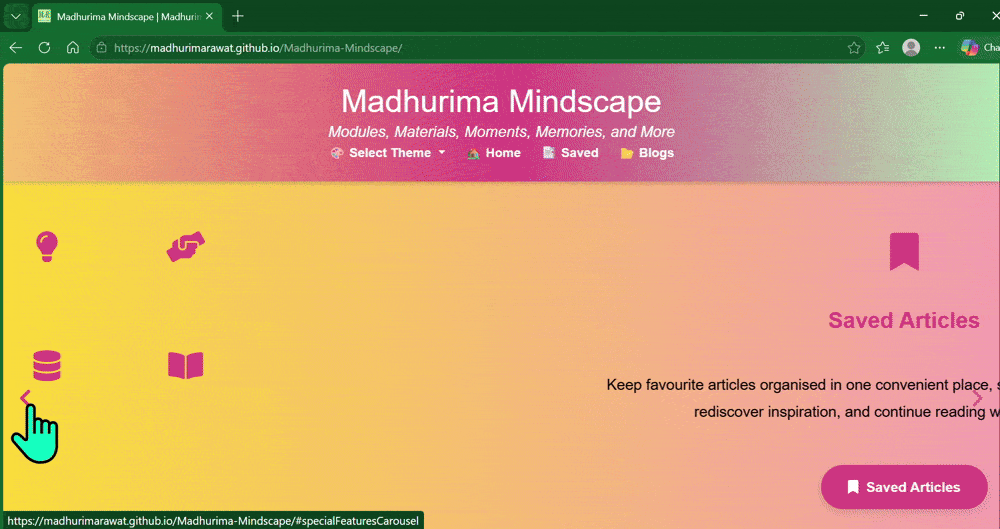
</a>
<br><br>
<a href="https://madhurimarawat.github.io/Madhurima-Mindscape" target="_blank">
  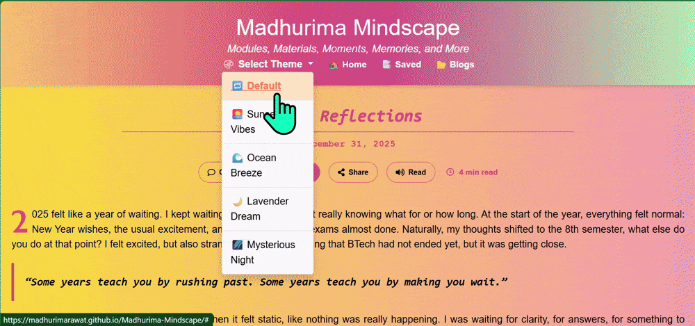
</a>

---

## Sections of the Blog

<h3>1. Introduction</h3>
An overview of the blog, my journey, and the thoughts behind it.

<h3>2. Personal Insights</h3>
Reflections on personal experiences, lessons learned, and everyday perspectives.

<h3>3. Tech Insights</h3>
Articles exploring tools, platforms, and technologies, along with experiences and practical advice.

<h3>4. Project Diaries</h3>
Behind-the-scenes stories and experiences from developing my projects.

<h3>5. Creative Clicks</h3>
A collection of photography and creative expressions through the lens.

<h3>6. Poem Perspectives</h3>
Poetry, literary reflections, and interpretations of meaningful works.

---

## Website Snapshots

<a href="https://madhurimarawat.github.io/Madhurima-Mindscape" target="_blank">
  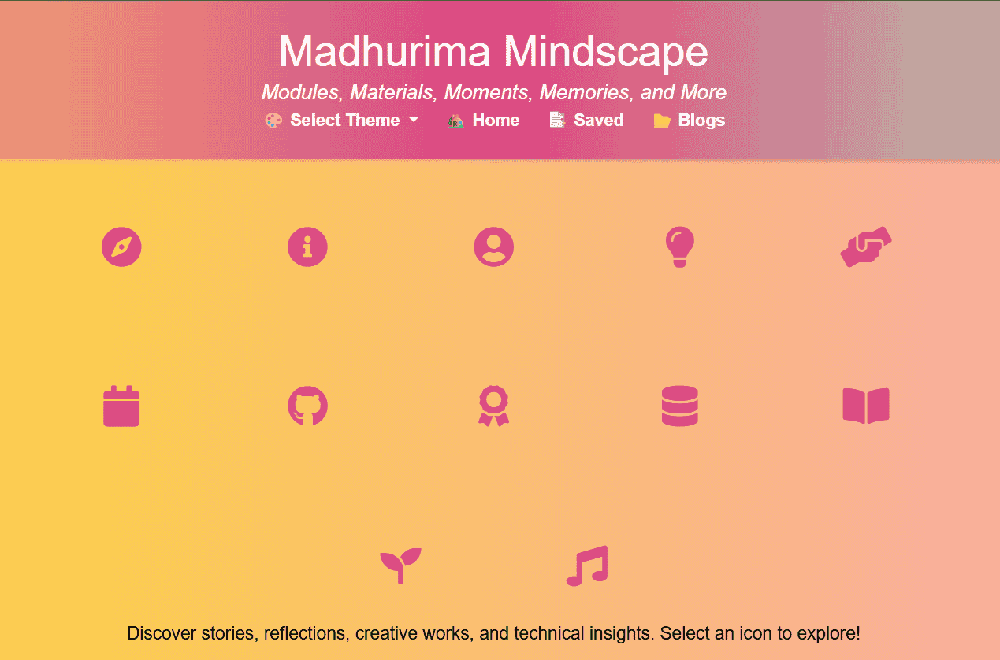
</a>
<br><br>
<a href="https://madhurimarawat.github.io/Madhurima-Mindscape" target="_blank">
  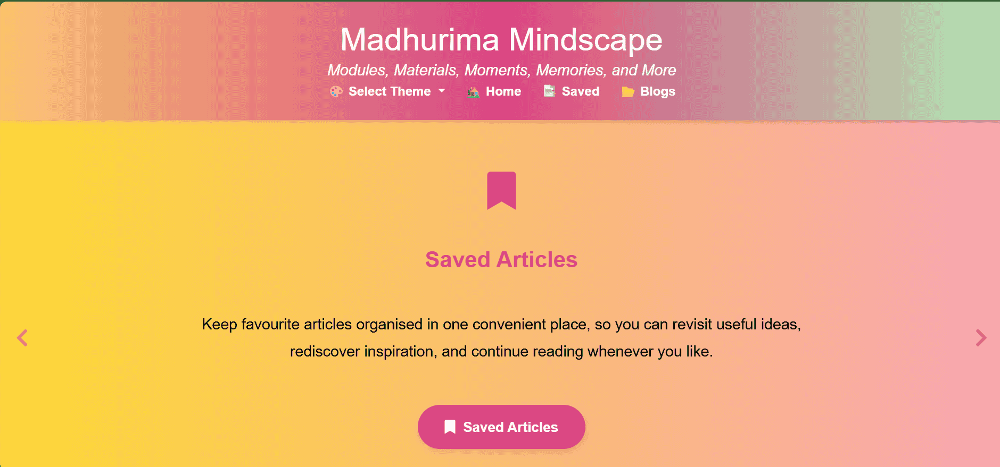
</a>
<br><br>
<a href="https://madhurimarawat.github.io/Madhurima-Mindscape" target="_blank">
  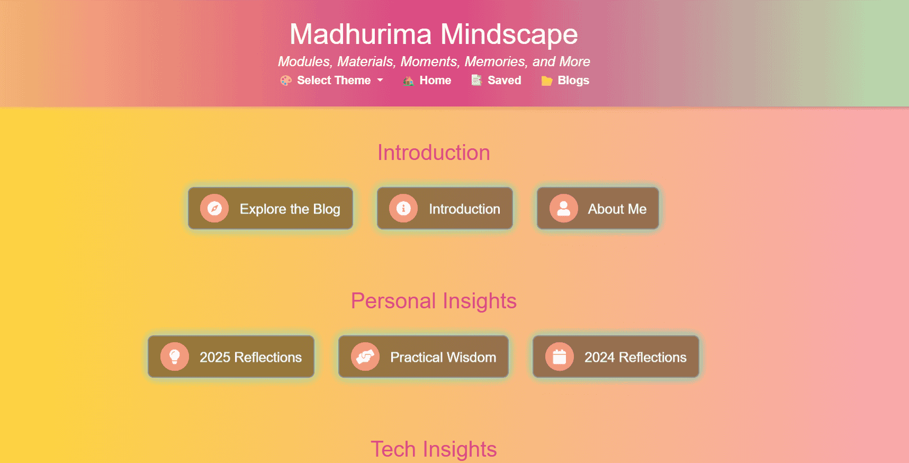
</a>
<br><br>
<a href="https://madhurimarawat.github.io/Madhurima-Mindscape" target="_blank">
  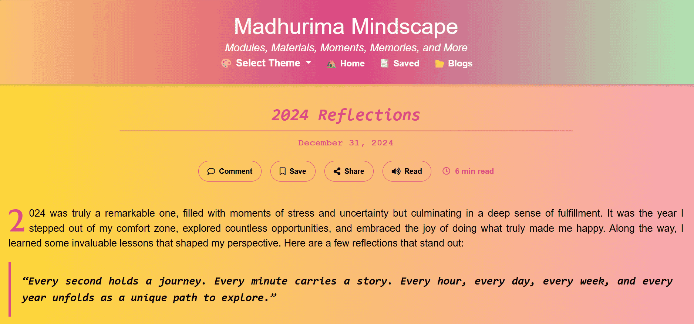
</a>
<br><br>
<a href="https://madhurimarawat.github.io/Madhurima-Mindscape" target="_blank">
  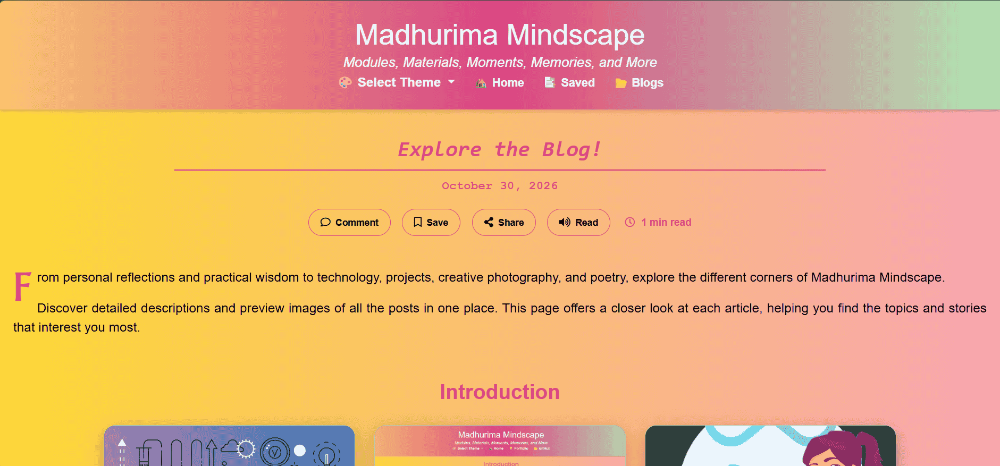
</a>
<br><br>
<a href="https://madhurimarawat.github.io/Madhurima-Mindscape" target="_blank">
  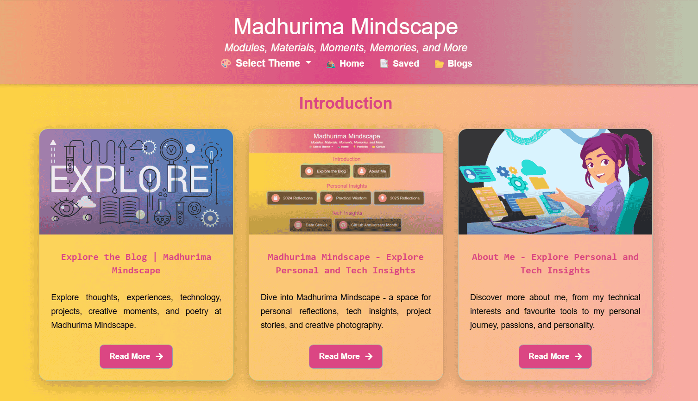
</a>
<br><br>
<a href="https://madhurimarawat.github.io/Madhurima-Mindscape" target="_blank">
  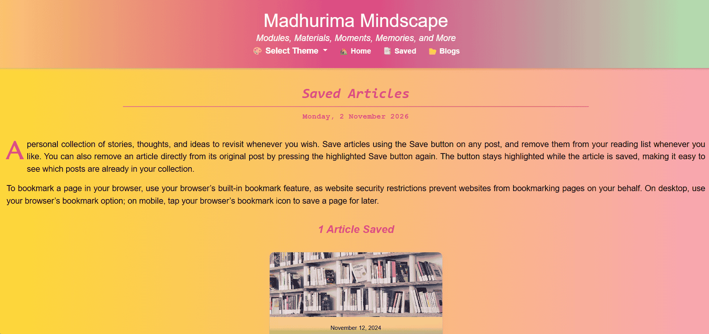
</a>
<br><br>
<a href="https://madhurimarawat.github.io/Madhurima-Mindscape" target="_blank">
  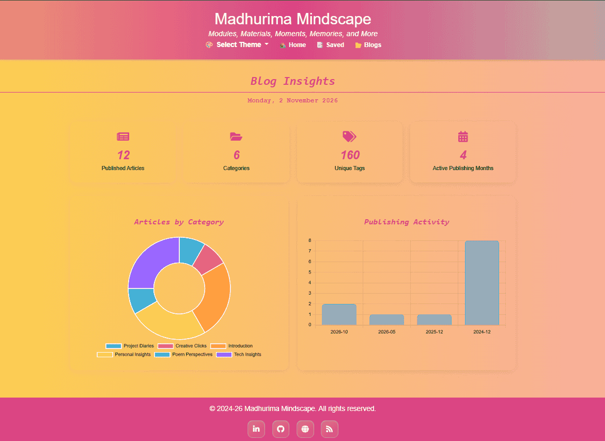
</a>
<br><br>
<a href="https://madhurimarawat.github.io/Madhurima-Mindscape" target="_blank">
  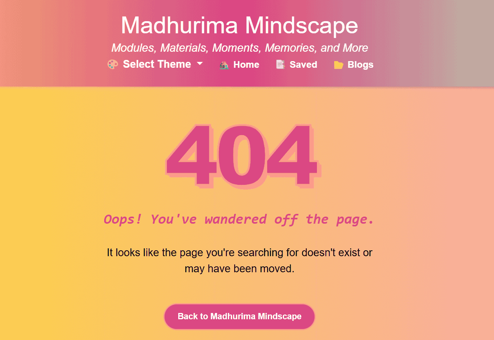
</a>

---

## Features

- **Jekyll-Powered Architecture:** Migrated to Jekyll with organized content, reusable layouts, includes, and structured YAML data.
- **Responsive Design:** Fully responsive interface for desktop, tablet, and mobile devices.
- **Dynamic Themes:** Multiple themes with dynamic, theme-aware colors and styling.
- **Interactive Icon Hero Section:** Font Awesome icons linked to individual blog posts, with an interactive slider and dynamic theme-based colors.
- **Reusable Blog Templates:** Consistent blog layouts and reusable components for managing articles.
- **Reading Time:** Displays estimated reading time for individual blog posts.
- **Read Aloud:** Listen to blog articles using browser speech synthesis.
- **Comment Functionality:** Interactive comment forms with predefined and custom comments, including email-based submission.
- **Save Articles:** Bookmark and unsave blog posts using browser LocalStorage.
- **Share Articles:** Share posts using the Web Share API, Clipboard API, and fallback options.
- **Explore the Blog:** Dedicated page displaying blog previews, titles, and descriptions for easy content discovery.
- **Saved Articles:** Dedicated section to view and manage bookmarked posts.
- **Blog Insights Dashboard:** Displays blog information, categories, tags, and article metadata using structured data and permalinks.
- **Blog Template Library:** Dedicated collection of reusable blog templates with categories, tags, and structured values.
- **SEO Optimization:** Individual YAML SEO metadata, XML sitemap, RSS feed, and `robots.txt`.
- **Custom 404 Page:** Dedicated responsive error page for unavailable URLs.
- **Social & Navigation Links:** Integrated navigation and footer links to LinkedIn, GitHub, Portfolio, and RSS feed.
- **Creative Exploration:** A platform for personal reflections, technology, project diaries, poetry, and photography.
  
---

## Documentation

For a detailed technical overview of Madhurima Mindscape, including its technology stack, features, Jekyll architecture, project structure, local development setup, and instructions for adding new blog posts, refer to the **[Project Documentation](Project_Documentation.md)**.

---

## Directory Structure

```text
Madhurima-Mindscape/
│
├── _data/              # YAML data and SEO metadata for blog pages
├── _includes/          # Reusable components and page imports
├── _layouts/           # Jekyll page layouts
├── _posts/             # Blog articles organized by category
├── blog-tools/         # Saved Articles, Blog Insights, and Blog Templates
│
├── css/                # Stylesheets and theme designs
├── js/                 # JavaScript functionality
├── images/             # Blog images and illustrations
├── website_snapshots/  # Website screenshots and GIF previews
│
├── _config.yml         # Jekyll configuration
├── index.html          # Homepage
├── 404.html            # Custom error page
├── Gemfile             # Ruby dependencies
├── Gemfile.lock        # Locked dependency versions
├── robots.txt          # Search engine crawling instructions
├── LICENSE             # Project license
└── README.md           # Project documentation
```

---

## Thanks for Visiting 😄

- Drop a 🌟 if you find this repository useful.<br><br>
- If you have any doubts or suggestions, feel free to reach me.<br><br>
📫 How to reach me:  &nbsp; [](https://www.linkedin.com/in/madhurima-rawat/) &nbsp; &nbsp;
<a href ="mailto:rawatmadhurima4@gmail.com"> </a><br><br>
- **Contribute and Discuss:** Feel free to open <a href= "https://github.com/madhurimarawat/Madhurima-Mindscape/issues">issues 🐛</a>, submit <a href = "https://github.com/madhurimarawat/Madhurima-Mindscape/pulls">pull requests 🛠️</a>, or start <a href = "https://github.com/madhurimarawat/Madhurima-Mindscape/discussions">discussions 💬</a> to help improve this repository!
